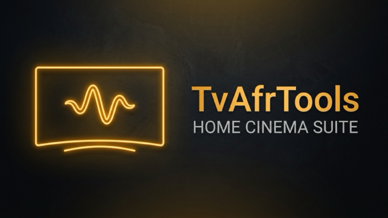

# 📺 TvAfrTools

**TvAfrTools** es una suite de herramientas nativa, ligera y de código abierto para **Android TV y Google TV** (desde Android 9.0 hasta Android 14). Ofrece soluciones avanzadas de hardware y control que habitualmente faltan o son exclusivas de aplicaciones de pago en dispositivos Android TV y Smart TVs.

> 🇬🇧 **[Read this guide in English](README.md)**

---

  

---

## ✨ Funcionalidades Principales

### 🎬 1. Auto Frame Rate (AFR) Universal sin Tirones (*Judder-Free*)
- **Sincronización exacta de Hz**: Detecta en tiempo real los fotogramas del vídeo (23.976p, 24.0p, 25p, 50p, 59.94p, 60p) y conmuta la frecuencia de refresco HDMI de tu TV para eliminar por completo los tirones (*judder*) al reproducir películas o series.
- **Compatible con Túnel Protegido Widevine L1**: Funciona incluso con vídeo protegido por DRM en apps de streaming oficial (**Netflix, Disney+, Prime Video, DAZN, Tivimate, Kodi**, etc.) mediante arquitectura híbrida *SurfaceFlinger* + Demonio ADB local.
- **Restauración automática a 60Hz**: Al salir de la película y volver al launcher (Android TV Home, Google TV o Projectivy Launcher), vuelve automáticamente a 60Hz.
- **Selector Manual Rápido**: Panel flotante interactivo para forzar cualquier frecuencia con las flechas del mando a distancia.

### ⚡ 2. Activación Autónoma por ADB Local (Sin PC ni Móvil)
- **Activación en 1 Clic**: Incluye su propio motor ADB interno (`127.0.0.1:5555`).
- Permite conceder permisos avanzados (`WRITE_SECURE_SETTINGS`, estadísticas de uso, etc.) directamente desde la TV sin tener que conectar ningún ordenador ni móvil.
- Compatible con el desbloqueo automático de **Ajustes Restringidos** en Android 13 y 14.

### 🎮 3. Mapeador de Botones del Mando con Anti-Rebote
- **Acciones personalizadas**: Asigna funciones a 1 Clic, Doble Clic o Pulsación Larga.
- **Acciones específicas en vídeo**: Posibilidad de configurar que un botón haga algo distinto mientras reproduces vídeo a pantalla completa.
- **Filtro Anti-Rebote (Debounce 220ms)**: Evita los molestos dobles clics accidentales provocados por mandos Bluetooth o por el retorno HDMI-CEC en televisores Samsung o LG.

### 🗂 4. Multitarea Flotante y Liberador Profundo de RAM
- **Selector de Apps Recientes**: Soluciona la falta de botón de multitarea en Android TV / Google TV o al usar launchers de terceros como Projectivy Launcher.
- **Liberación de Memoria Real**: Escanea los procesos activos en segundo plano (`ps -A`), los finaliza forzosamente (`am force-stop` y nivel SDK) y mide en tiempo real los MB de memoria RAM liberados.
- **Cambio rápido o cierre**: Pulsa `OK` para ir a una app, o mantén pulsado `OK` para cerrarla por completo.

### 🌑 5. Apagado Real de Pantalla (Modo Música)
- Apaga la pantalla del televisor mientras el sonido continúa reproduciéndose.
- Ideal para escuchar **Spotify**, **YouTube**, radio o podcasts en televisores OLED o LED sin riesgo de quemados y ahorrando energía. Al pulsar cualquier tecla del mando, la pantalla vuelve al instante.

### 📊 6. HUD Técnico en Pantalla
- Panel flotante con información técnica en tiempo real:
  - Resolución HDMI y Hz actuales.
  - FPS reales del vídeo y motor de renderizado.
  - Temperatura del procesador (SoC) en °C.
  - Consumo y velocidad de red (Kb/s, Mb/s).
  - Memoria RAM libre y total.

### 🌐 7. Mando a Distancia Web desde el Móvil
- Servidor web ultraligero integrado (puerto `8080`).
- Abre la IP de tu TV en el navegador de tu móvil o tablet para navegar o **pegar contraseñas largas y enlaces** cómodamente con el teclado del móvil.

### 🔄 8. Actualizador Automático desde GitHub
- Comprueba si hay nuevas versiones publicadas en GitHub Releases.
- Descarga e instala la actualización directamente en tu televisor sin necesidad de volver a pasar archivos por pendrive ni Downloader.

---

## 📺 Dispositivos Compatibles

- **Sistema Operativo**: Android TV / Google TV 9.0 (API 28) hasta Android 14 (API 34).
- **Plataformas Soportadas**: **Exclusivamente Android TV y Google TV estándar / certificado (Android 9.0 a 14)**.
- **Modelos Probados y Verificados**:
  - Homatics Box R 4K Plus / cajas SEI Robotics (Amlogic S905X4)
  - Xiaomi Mi TV Box S (1ª y 2ª Gen) / Mi TV Stick 4K
  - Chromecast con Google TV (HD y 4K)
  - NVIDIA Shield TV / Shield TV Pro
  - Nokia Streaming Box 8000 / 8010
  - Strong Leap-S1 / S3 y demás reproductores con Android TV / Google TV oficial.
- ⛔ **Amazon Fire TV / Fire OS NO es compatible**:
  - Amazon bloquea por firmware las conexiones ADB locales (`127.0.0.1:5555` - CVE-2024-27350), impidiendo la activación autónoma en 1 clic.
  - Fire OS oculta los servicios de accesibilidad de terceros en los ajustes del sistema.
  - La pila de vídeo de Amazon y sus procesadores MediaTek bloquean el cambio forzado de Hz (AFR) en apps de streaming externas.

---

## 🚀 Instalación y Puesta en Marcha

1. **Descarga el APK**:
   - Descarga la última versión `TvAfrTools-vX.X.X.apk` desde [GitHub Releases](https://github.com/TSCNEO/TvAfrTools/releases/latest).
   - O introduce el enlace directo en la app **Downloader** de tu televisor.
2. **Instala y Concede Permisos**:
   - Abre TvAfrTools en la tele.
   - Pulsa en **"⚡ Activar automáticamente en 1 clic"**.
   - Si sale el mensaje en pantalla *"¿Permitir depuración USB?"*, marca *"Permitir siempre"* y pulsa **OK**.
3. **¡Listo!** Ya puedes configurar el cambio de Hz, el mando y la multitarea.

---

## 🤝 Soporte y Reporte de Fallos

¿Has encontrado algún fallo o tienes alguna idea para mejorar la app?
- 🐛 **Reportar un Error**: [Abrir un Issue en GitHub](https://github.com/TSCNEO/TvAfrTools/issues/new?template=bug_report.md)
- 💡 **Sugerir Funcionalidades**: [Proponer una Mejora](https://github.com/TSCNEO/TvAfrTools/issues/new?template=feature_request.md)
- ⭐ Si te resulta útil el proyecto, ¡dale una estrella en GitHub!

## Hoja de ruta

[Hoja de ruta](ROADMAP.md)
